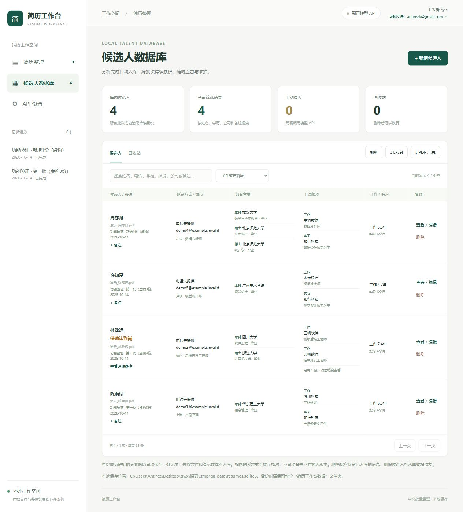

# 简历工作台

开发者：Kyle · [问题反馈](mailto:antirezk@gmail.com)

[下载 Windows 免安装版 v1.4.0](https://github.com/Antirezk/resume-workbench/releases/tag/v1.4.0) · [第三方组件与来源说明](THIRD_PARTY_NOTICES.md)

本仓库保存应用源码，EXE 通过 GitHub Releases 提供。候选人资料、原始简历、数据库、日志与 API 密钥均不随仓库或发布包分发。


本地运行的中文简历批量整理工具。每批最多 50 份，ZIP 按解压后支持的简历文件数量计算。支持 PDF、DOCX、TXT、JPG、PNG 和 ZIP；模型 API 提取结构化信息，导出 Excel 和中文 PDF 汇总报告。

## 界面预览

下图使用虚构候选人，展示两批简历“3 份 + 1 份”累积为 4 条记录的效果。



## 使用

Windows 免安装版：双击 `简历工作台.exe`，无需安装 Python。适用于 Windows 10/11 64 位，内置中文 OCR 模型和可分发的中文字体。程序会打开浏览器并显示托盘图标，可在托盘菜单打开界面、查看数据目录或退出。EXE 默认在同目录的“简历工作台数据”文件夹保存数据。

1. 双击 `start.bat`。浏览器会打开 `http://127.0.0.1:8765`。首次启动会在项目 `.venv` 中安装依赖；首次 OCR 使用会按 RapidOCR 的版本和模型配置加载或下载模型。
2. 点击「API 设置」，选择通义千问、DeepSeek 或自定义兼容服务。填写 API 地址、模型名称和 API Key，点击「测试连接」再保存。API Key 只保留在当前网页内存中，刷新页面后需重新填写；其他设置会记在浏览器中。
3. 上传简历或 ZIP，程序自动统计其中支持的简历文件数量，无需选择份数。每份文件计为一份简历；ZIP 按其中支持的文件数量计数，忽略目录和不支持的附件。超过 50 份会在开始处理前提示。填写批次名称，点击「开始整理」；程序根据待处理数量自动安排并发（最多同时处理 3 份），扫描页面自动执行本地 OCR。
4. 查看结果，点击「查看」核对原文并修改。批次完成后可导出整批 Excel 和 PDF。失败文件可重试，不会重新处理已经成功的文件。
5. 每位候选人的备注分为两段：短备注（最多 50 字、单行）直接显示在姓名下方，可选择常用字体颜色或自定义颜色；详细备注（最多 5000 字）需点击“查看详细备注”或进入候选人详情查看，列表不展开详细内容。点击姓名下方的“+ 备注 / 编辑备注 / 查看详细备注”或详情页顶部，可编辑两段内容并预览颜色。清空相应内容后保存即可删除；支持搜索，Excel 保留独立短备注、详细备注、颜色列及短备注字体色，PDF 保留姓名下方的彩色短备注与独立详细备注。备注独立保存在本机，重新提取或重启均保留，不会发送给模型 API；旧版备注保留为详细备注，短备注默认空白。

如果本机已经有工具运行，启动脚本会直接打开现有页面。自行启动时请保持启动窗口运行。关闭网页不影响后台任务；关闭启动窗口会终止程序。重启后会保留已完成结果，并将未完成文件标为可重试。已有“简历工作台数据”文件夹时，源码与 EXE 共用该目录；独立源码目录默认使用 `data/`。删除批次会删除该批次的本地原始文件和批次记录，已入库的候选人资料保留。

不提供 API Key 时仍可点击「查看演示数据」体验编辑、筛选和导出。演示人物、公司、经历为虚构，不代表实际解析效果。

## 候选人数据库

左侧“候选人数据库”是本地人才库入口。每份真实简历成功分析后自动入库，跨批次累积；例如先分析 3 份，再分析 1 份新的简历，数据库共 4 条记录。原有真实批次的成功结果会在升级时自动纳入。失败、等待和演示数据不入库；同批次的内容重复文件仅保留成功解析的那条。重新提取同一条记录会更新原记录，不增加数量。不同批次的简历版本分别保存，相同联系方式会提示核对，避免错误合并同名候选人。

数据库支持姓名、电话、学校、公司、技能与备注搜索、教育阶段筛选、分页查看、手动新增、完整资料编辑、短备注/颜色与详细备注编辑。手动维护和导出无需调用模型 API。修改会同步到仍存在的原批次；原批次更新期间暂不能修改简历资料，但可以单独保存备注。删除候选人会移到回收站，可以恢复；重启或重新提取不会使已删除的记录自动回到正常列表。

人才库独立保存结构化资料、原文文字及备注。删除批次和原始简历文件不会删除已入库的资料，仍可查看和编辑。数据库可导出当前搜索与教育阶段筛选的全部候选人，包含所有分页。数据库文件为“简历工作台数据/resumes.sqlite3”，页面底部会显示实际路径；备份时保留整个数据文件夹。

开发者 Kyle。网页右上角提供“问题反馈”邮件入口：[antirezk@gmail.com](mailto:antirezk@gmail.com)。点击后打开本机默认邮件应用；由使用者自行填写和发送反馈。上传数量统计在本机完成，不调用模型 API 或保存批次。

## 报表

- Excel：候选人总表、工作经历、实习经历、其他任职经历、教育经历、项目经历、证书奖项与学术成果、语言能力、作品集与个人主页、原文证据、未成功与重复文件，共 11 张表。联系电话作为文字保存，避免科学计数法；首行和姓名列冻结、支持筛选。
- 任职信息：公司、岗位、部门、工作地点、起止时间、每段月数/年数、职责、量化成果、自述时长和原文证据逐条保留。同公司不同岗位分别列出，工作与实习分别累计；兼职、劳务和性质未明确的经历独立保留。
- 求职信息：现居城市和期望城市分开，记录原文明示的求职状态、到岗时间、自述工作年限。项目保留本人角色、日期、技术栈和成果；证书、奖项、语言成绩、作品集按原文记录，缺失内容留空。
- 旧批次可点击“补全实习 / 工作信息”再次调用 API。未人工修改的经历会重新提取；已人工修改的列表只为名称、岗位、开始日期等匹配的条目补空字段，保留人工内容与删除操作，不自动加入不匹配条目；请核对原文后手动添加这些条目。联系方式、教育信息和既有求职字段保持原值，API 失败保留原数据。
- 教育信息：本科、硕士、博士分别提供院校、专业、学位、就读时间和毕业状态等独立筛选列；教育明细逐条保留学院、学习形式、研究方向、学习详情与原文，同阶段多学位、多校不会合并覆盖。只写“研究生”的记录保留层次不明确提示。
- 旧批次可点击“重新提取教育信息”，从保存的原文再次调用模型补全教育经历。其他人工修改会保留；API 失败会保留原教育信息。未在原文出现的学校、专业、成绩等不会补造。
- PDF：处理统计、教育阶段分布、高频技能、候选人总览、完整教育明细、工作/实习累计、全部公司岗位时间与职责成果、项目与补充信息、逐人摘要以及未成功文件说明。使用内置 Noto Sans SC 字体显示中文。
- 年限：按明确年月计算（含首尾月，非精确天数），各类重叠月份去重。工作与实习分别累计，兼职、劳务/自由职业和性质未明确的经历不计入两项累计。只有年份、缺失、倒置或未来日期不计算；无可计算区间时显示“未能计算”，不是零年；部分可计算时注明仅已知经历。原文自述年限独立保存。统计按成功简历份数计。内容完全相同的文件仅解析一次；相同联系方式仅提示核对，不自动删除。
- 模型只整理简历事实，不自动评分或作录用决策。保留关键字段的原文证据；人工修改不会重新调用模型。

## API 设置

接口需要兼容 `POST /chat/completions`，返回 `choices[0].message.content`。JSON 模式默认发送 `response_format: {"type":"json_object"}`。若服务商不支持此参数，在设置中关闭 JSON 模式；本地仍会校验字段和 JSON。API 提取可能出错，应结合原文核对重要字段。

通义千问中国内地地址：`https://dashscope.aliyuncs.com/compatible-mode/v1`；新加坡地址：`https://dashscope-intl.aliyuncs.com/compatible-mode/v1`。API Key 与模型权限须对应相同地域。DeepSeek：`https://api.deepseek.com/v1`。名称、价格和权限以供应商文档与账号为准。

也可在启动前设置 `RESUME_API_KEY`、`RESUME_BASE_URL` 和 `RESUME_MODEL`。不把密钥写进源代码、URL 或报表。工具只监听本机地址，不适合直接开放到公网。

## 文件限制

每份 20 MB，每批解压后 120 MB，最多 50 份，单份 PDF 最多 30 页、文字最多 60,000 字符。旧版 `.doc` 应先转换成 `.docx` 或 PDF。密码保护文件需先解密。OCR 识别受扫描清晰度影响；多栏简历提取顺序异常时，可开启强制 OCR 后重试。

## 手动运行与验证

需要 Python 3.10+。启动脚本使用项目虚拟环境，避免修改全局 Python。

```powershell
python -m venv .venv
.\.venv\Scripts\python.exe -m pip install -r requirements.lock.txt
.\.venv\Scripts\python.exe app.py
.\.venv\Scripts\python.exe -m unittest discover -s tests -v
```

更换端口：`python app.py --port 8766`。不自动打开浏览器：`python app.py --no-browser`。

## 开源组件与文档

- [Flask](https://github.com/pallets/flask)：本地界面服务。
- [pypdf](https://github.com/py-pdf/pypdf)：PDF 文字读取。
- [RapidOCR](https://github.com/RapidAI/RapidOCR)：中文扫描件识别，CPU 推理，无需 GPU。
- [pypdfium2](https://github.com/pypdfium2-team/pypdfium2)：PDF 页面渲染。
- [python-docx](https://github.com/python-openxml/python-docx)：DOCX 读取。
- [ReportLab](https://github.com/MrBitBucket/reportlab-mirror)：中文 PDF 报告。
- Excel 导出使用标准 OOXML，不依赖本机 Excel 安装。
- [阿里云兼容接口](https://help.aliyun.com/zh/model-studio/qwen-api-via-openai-chat-completions/)；[JSON 输出说明](https://help.aliyun.com/zh/model-studio/qwen-structured-output)。

这是基于开源组件的集成开发：应用层负责批次处理、简历字段整理、本地候选人数据库、备注、界面和报表；OCR、文档解析、推理运行时与字体来自第三方。当前仓库未作为某个完整简历应用项目的 fork 发布。引用开源库或参考接口文档与直接修改既有项目代码是不同的来源关系；组件、模型与字体的来源和许可见 [THIRD_PARTY_NOTICES.md](THIRD_PARTY_NOTICES.md)。

应用代码采用 [MIT](LICENSE) 许可证，第三方代码、模型与字体保留其各自许可证。内置中文字体为 Noto Sans SC，许可原文保存在 [fonts/OFL.txt](fonts/OFL.txt)，无需用户安装字体。EXE 保留已收集的运行依赖许可，可从系统托盘的“开源组件许可”入口查看。

## 构建 Windows EXE

在 Windows 64 位环境安装锁定依赖与打包依赖后执行：

```powershell
.\.venv\Scripts\python.exe -m pip install -r packaging/requirements-build.txt
.\.venv\Scripts\python.exe -m PyInstaller --noconfirm --distpath output/windows --workpath build/windows packaging/windows.spec
```

输出文件为 `output/windows/简历工作台.exe`。发布前应核对 OCR 模型、字体和第三方许可已打包。v1.4.0 已通过 37 项单元测试，以及独立目录下的 EXE 启动、离线 OCR、50 份模拟 API 批量处理、数据库增删查改和 Excel/PDF 导出验证；模拟 API 测试不代表真实模型提取准确率。
